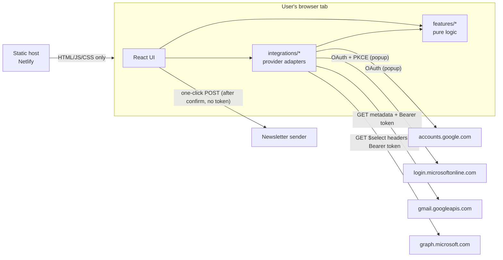
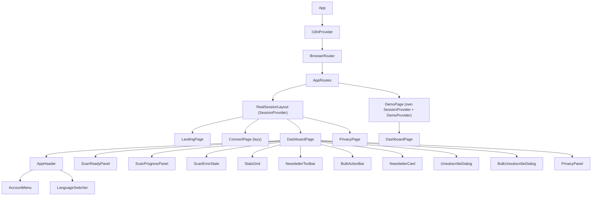
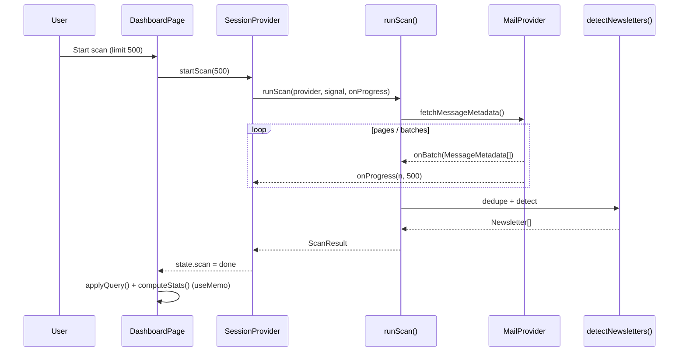
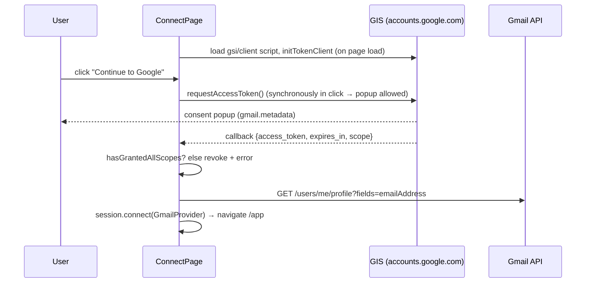
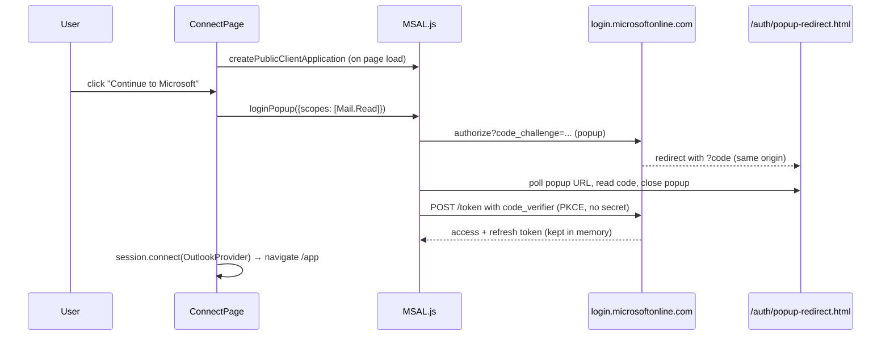
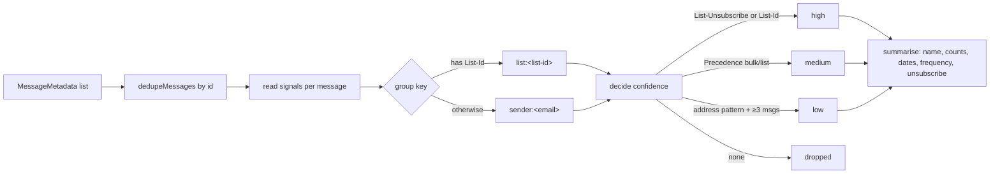
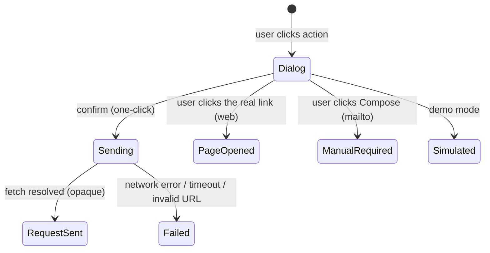
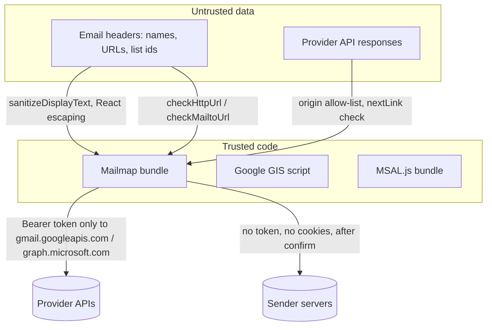

# Mailmap architecture

This document explains how Mailmap is built and, more importantly, **why**. It is written for someone reading the code for the first time.

## 1. Overall architecture

Mailmap is a **single-page application with no backend**. Everything — sign-in, API calls, detection, unsubscribe — happens in the user's browser tab.



The static host only serves files. It never sees tokens or mailbox data.

### Feasibility assessment (why browser-only works)

| Requirement                | Browser-only?     | Notes                                                                                                                                                                                                                               |
| -------------------------- | ----------------- | ----------------------------------------------------------------------------------------------------------------------------------------------------------------------------------------------------------------------------------- |
| Google sign-in             | Yes               | Google Identity Services **token model** is Google's documented approach for browser apps. Auth-code + PKCE for "Web application" clients requires a client secret at the token endpoint, which cannot be kept secret in a browser. |
| Microsoft sign-in          | Yes               | MSAL.js uses Authorization Code + PKCE for **SPA** app registrations; no secret.                                                                                                                                                    |
| Gmail API from browser     | Yes               | Gmail REST API supports CORS with bearer tokens.                                                                                                                                                                                    |
| Graph API from browser     | Yes               | Graph supports CORS for SPAs.                                                                                                                                                                                                       |
| Header-only Gmail access   | Yes               | `gmail.metadata` scope; `format=metadata` + `metadataHeaders`. But `q` search is not allowed with this scope.                                                                                                                       |
| Header-only Outlook access | Partly            | `$select=internetMessageHeaders` works, but the minimal permission that is _documented_ to include headers is `Mail.Read`, which also allows bodies.                                                                                |
| One-click unsubscribe      | Yes, with caveats | A `no-cors` POST can be sent but its response is unreadable, so success cannot be confirmed. CSP must allow `connect-src https:`.                                                                                                   |
| Mailto unsubscribe         | Manual only       | Sending would need `gmail.send` / `Mail.Send`. Mailmap deliberately doesn't request them.                                                                                                                                           |
| Refresh tokens             | Microsoft only    | MSAL gets SPA refresh tokens (in memory here). GIS token model issues none, so Gmail sessions last ~1 hour.                                                                                                                         |

Conclusion: a browser-only architecture is viable and is the safest option, because no server ever holds tokens or mail data. The documented limitations are acceptable for this product.

## 2. Folder structure

```
src/
  app/            App.tsx – providers and routes
  pages/          One component per route (Landing, Connect, Dashboard, Demo, Privacy, NotFound)
  components/
    ui/           Design-system primitives: Button, Badge, Card, Dialog, Icon, Logo, Avatar, Notice, Spinner
    layout/       Headers, footer, language switcher, account menu, skip link
    landing/      Dashboard illustration for the landing page
    dashboard/    Stats grid, toolbar, scan panels, empty/error states, bulk bar
    newsletter/   Newsletter card, badges, single + bulk unsubscribe dialogs
  features/       Business logic with no React (except session/*Provider)
    discovery/    headers.ts, detect.ts, frequency.ts, scan.ts
    unsubscribe/  classify.ts, oneClick.ts, bulk.ts
    dashboard/    query.ts (search/filter/sort), stats.ts
    session/      sessionReducer.ts, SessionProvider.tsx, sessionContext.ts
  integrations/   MailProvider interface, HTTP helper, gmail/, outlook/
  demo/           Synthetic mailbox + DemoProvider
  i18n/           translate.ts, I18nProvider, messages/en.ts + nb.ts
  hooks/          useI18n, useSession, useOutcomeLabel
  types/          Shared types (mail.ts, newsletter.ts, GIS declarations)
  utils/          url.ts, emailAddress.ts, text.ts, async.ts, cx.ts
  styles/         Tailwind entry + design tokens
  test/           Test setup, fixtures, render helper
tests/e2e/        Playwright specs
```

Unit tests sit next to the code they test (`detect.ts` → `detect.test.ts`). This keeps tests easy to find; end-to-end tests live in `tests/e2e` because they test the whole app.

## 3. Component hierarchy



`DashboardPage` is used for both real and demo sessions. It doesn't know which one it shows; it asks the session's `provider.isSimulation`.

## 4. Data flow



Key ideas:

- **One-way data flow.** State lives in `SessionProvider` (`useReducer`). Components read it via `useSession()` and call commands like `startScan` or `toggleSelected`.
- **Derived data is computed, not stored.** Filtered lists and statistics are recomputed with `useMemo` from the newsletter list. They can never get out of sync.
- **Pure functions do the real work.** `detectNewsletters`, `applyQuery`, `computeStats`, `classifyUnsubscribe` and `sessionReducer` have no side effects, which makes them easy to test.
- **Search/filter/sort state is local** to `DashboardPage`, because nothing else needs it.

## 5. Authentication flows

### Gmail (Google Identity Services token model)



- The token is held in a private field of `GmailProvider` (memory only).
- No refresh token. When it expires, API calls throw `unauthorized` and the UI offers **Reconnect**.
- **Disconnect** calls `google.accounts.oauth2.revoke`, which revokes the grant at Google.

### Outlook (MSAL.js, Authorization Code + PKCE)



- `cacheLocation: memoryStorage` — tokens disappear on refresh. MSAL keeps short-lived interaction state in `sessionStorage` while the popup is open.
- Every Graph call goes through `acquireTokenSilent`, which refreshes in the background. If interaction is required, the UI shows **Reconnect**.
- **Disconnect** clears MSAL's cache. Consent at Microsoft remains until the user removes it.

## 6. Gmail integration

Files: `integrations/gmail/gmailAuth.ts`, `gmailClient.ts`, `gmailProvider.ts`.

1. `users.messages.list?maxResults=100&fields=messages/id,nextPageToken` — ids only, newest first, spam/trash excluded by default.
2. For each id, `users.messages.get?format=metadata&metadataHeaders=From&metadataHeaders=List-Unsubscribe&...&fields=id,internalDate,payload/headers` — six headers, nothing else (the `fields` parameter also drops `snippet`).
3. Requests run with a concurrency of 6. Gmail's per-user quota is 250 units/second and a `get` costs 5 units; verify current numbers in Google's quota docs.
4. 429, 5xx and 403 `rateLimitExceeded` are retried with exponential backoff (honouring `Retry-After`).

## 7. Outlook integration

Files: `integrations/outlook/outlookAuth.ts`, `outlookClient.ts`, `outlookProvider.ts`.

1. Look up the ids of `junkemail` and `deleteditems` (because `/me/messages` includes all folders).
2. `GET /v1.0/me/messages?$select=id,from,receivedDateTime,parentFolderId,internetMessageHeaders&$orderby=receivedDateTime desc&$top=50`.
3. Follow `@odata.nextLink` **only if** it points to `https://graph.microsoft.com/v1.0/me/messages` (`isSafeNextLink`). A tampered response can't redirect the token elsewhere.
4. If Graph returns messages but never any headers, throw `headers-unavailable` instead of silently showing "no newsletters".

## 8. Newsletter discovery

Files: `features/discovery/*`.



- **Name:** from the newest message, sanitized (control, bidi and zero-width characters removed).
- **Frequency:** median gap between messages; needs ≥3 messages, otherwise "not enough data". Always labelled as an estimate.
- **Unsubscribe info:** from the newest message that has a `List-Unsubscribe` header.
- Words like `noreply` or `info` are deliberately _not_ newsletter patterns, because receipts and security alerts use them.

## 9. Unsubscribe workflow

Files: `features/unsubscribe/*`, `components/newsletter/*Dialog.tsx`.

### Classification (`classifyUnsubscribe`)

| Advertised URI                                                       | Extra conditions                                                                                                 | Result                                      |
| -------------------------------------------------------------------- | ---------------------------------------------------------------------------------------------------------------- | ------------------------------------------- |
| `https://…`                                                          | `List-Unsubscribe-Post: List-Unsubscribe=One-Click` **and** `dkim=pass` in the provider's Authentication-Results | **one-click**                               |
| `https://…`                                                          | otherwise                                                                                                        | **web** page                                |
| `http://…`                                                           | —                                                                                                                | **web** page, flagged insecure, ranked last |
| `mailto:…`                                                           | single valid address                                                                                             | **mailto** (cc/bcc dropped)                 |
| `javascript:`, `data:`, IP hosts, localhost, odd ports, credentials… | —                                                                                                                | rejected and counted                        |

### Execution



- **One-click:** `fetch(url, {method:'POST', mode:'no-cors', credentials:'omit', referrerPolicy:'no-referrer', body:'List-Unsubscribe=One-Click'})`. No token, no cookies, no referrer. Result: "Request sent" — never "Unsubscribed".
- **Web / mailto:** a real `<a>` the user clicks (`target=_blank rel="noopener noreferrer"` for web). Mailmap never opens links by itself, and never during scanning.
- **Bulk:** the dialog groups the selection into _sent automatically_ / _needs your action_ / _not available_. One confirmation sends the one-click batch (concurrency 2); the others get individual buttons; results are shown per item.

## 10. Error handling

- Provider code throws `ProviderError` with a **code** (`unauthorized`, `rate-limited`, `popup-blocked`, …). Messages never include tokens, URLs or mailbox data.
- The UI maps each code to a translated message (`errors.*` keys).
- `unauthorized` → **Reconnect** button; others → **Try again**.
- Cancelling a scan is not an error: `runScan` returns the partial result with `partial: true`, and the dashboard shows a notice.
- Stale results are ignored: if a newer scan started, the old one's result is dropped (`scanController.current === controller` check).

## 11. Security boundaries



- **Tokens** are sent only to allow-listed API origins (`authorizedGetJson` refuses others).
- **Header text** is rendered as plain text by React; `dangerouslySetInnerHTML` is banned by ESLint.
- **URLs** must pass `checkHttpUrl` before they can be shown as links or used for requests, and are checked again right before sending.
- **CSP** (`public/_headers`) restricts scripts to self + Google's GIS, frames to the two identity providers, and blocks objects and framing.

## 12. Design decisions and trade-offs

| Decision                        | Why                                                                                    | Trade-off                                               |
| ------------------------------- | -------------------------------------------------------------------------------------- | ------------------------------------------------------- |
| No backend                      | Nothing sensitive leaves the browser; free static hosting                              | No Gmail refresh tokens; CSP needs `connect-src https:` |
| GIS token model for Gmail       | Google's documented browser flow; no secret                                            | ~1h sessions; Google script runs in the page            |
| MSAL popup + memory cache       | Tokens never persisted; no full-page redirect losing state                             | Requires pop-ups; popup redirect page must stay blank   |
| `Mail.Read` default for Outlook | Header access with `Mail.ReadBasic` is not documented; failing silently would be worse | Broader permission than ideal (disclosed in UI)         |
| Header-only detection           | Privacy                                                                                | Misses newsletters without standard headers             |
| One-click only with DKIM pass   | RFC 8058 requires DKIM; reduces spoofed-header risk                                    | Some legitimate one-click senders become "web page"     |
| No sender logos                 | Fetching favicons leaks the user's newsletter list to third parties                    | Less visual polish                                      |
| Own i18n helper                 | Tiny, fully typed keys; Norwegian completeness enforced by the compiler                | No ICU message syntax (only simple plurals)             |
| `useReducer` + Context          | One in-memory session; no extra library to learn                                       | Would need rethinking if the app grows a lot            |
| Native `<dialog>`               | Built-in focus trap, Escape, inert background                                          | Needs a small polyfill in jsdom tests                   |
| Separate session for demo       | Demo data can never mix with real data                                                 | Leaving `/demo` resets the demo                         |
| Lazy-loaded ConnectPage         | Landing/demo visitors don't download MSAL (~75 KB gzip)                                | Tiny delay when opening the connect page                |
